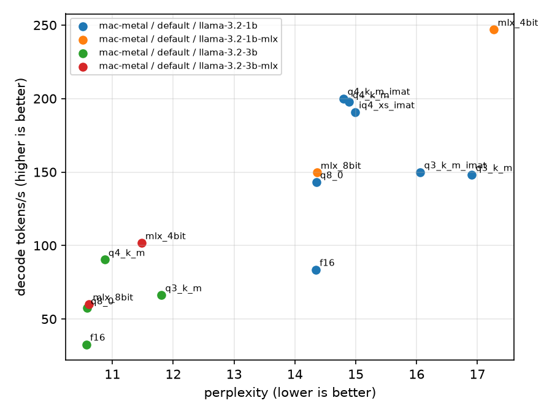
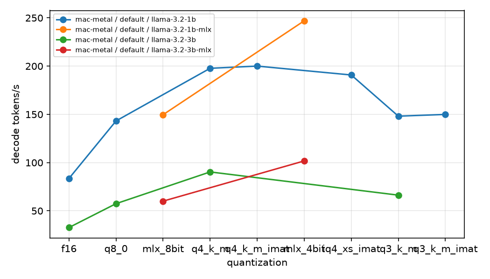
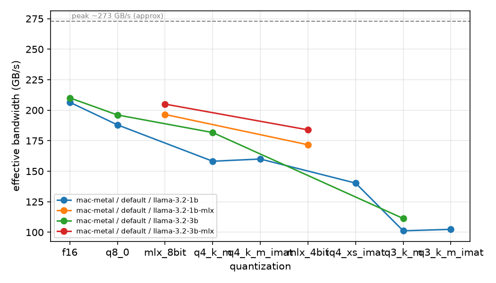

# edge-llm-bench

Config-driven benchmark harness that takes a small LLM through several quantization levels and measures
**latency, power and accuracy** on edge hardware. One YAML file defines the matrix
(power mode x model x quantization); results are resumable JSONL; a report step builds the table and plots.

Phase 1 runs on an Apple Silicon Mac GPU (Metal). Phase 2 runs the same matrix on a Jetson Orin Nano over SSH.
Only the config changes.

## Quick start (Mac)

```bash
bash scripts/setup_mac.sh                  # build llama.cpp, fetch F16 model, quantize, fetch WikiText-2
pip install -e ".[dev]"
python -m pytest                           # parser/pipeline tests, no hardware needed
sudo -v && sudo -E edgebench-run --config configs/mac-metal.yaml     # sudo only for powermetrics
edgebench-report --results results --out report
```

`powermetrics` needs root. Either run the harness with `sudo -E`, or set `power: none` in the config to skip power.
Report output: `report/results.md`, `decode_tps.png`, `perplexity.png`, `energy.png`, `tradeoff.png`.

## What is measured

| Metric | Source |
|---|---|
| Prefill / decode tokens per second | `llama-bench` (JSON) |
| Model size | `llama-bench` |
| Mean / max power | `powermetrics` (Mac) or `tegrastats` (Jetson) sampled during each run |
| Energy per token (approx.) | mean power / decode tokens-per-second |
| Perplexity | `llama-perplexity` on WikiText-2 (hardware-independent for identical GGUFs) |

## MLX runtime (Apple Silicon)

A model entry with `runtime: mlx` is benchmarked with `python -m edgebench.mlx_bench`, which prints
llama-bench-style JSON, so MLX rows land in the same results file and report. Point each quant at an MLX model
directory (see `configs/mac-metal.yaml`). Perplexity is not computed for MLX models here.
MLX 4-bit (group size 64) is about 4.5 bits per weight and is not the same format as llama.cpp Q4_K_M
(about 4.9), so compare on size and bandwidth as well as bit width.

## Known limitations (state these in your write-up)

- Mac `powermetrics` reports CPU+GPU+ANE package power, not wall power. Jetson `VDD_IN` is module input power.
  Absolute joules are **not comparable across devices**; compare quantization levels within a device.
- Energy/token uses the whole bench window (includes model load and prefill), so it is an upper bound.
- Apple Silicon has unified memory and different bandwidth from the Orin Nano, so rankings of quant levels
  can differ between devices. That difference is a finding, not a bug.
- Thermal throttling matters: use the cooldown setting and note ambient conditions.
- Verify `llama-bench` JSON field names and `tegrastats` rail names against your builds; parsers are in
  `llamacpp.py` and `power.py` with unit tests.

## Roadmap

1. Mac baseline matrix (1B model, 4 quants) and first report.
2. Add 1.5B and 3B models; add a second runtime (e.g. MLX on Mac) for comparison.
3. Jetson Orin Nano: flash, build llama.cpp with CUDA, run `configs/jetson-orin-nano.yaml`, sweep power modes.
4. CI workflow, polished charts, blog post.


## How power is measured

- On macOS, `powermetrics` is sampled in short bounded calls while the benchmark runs. Each record stores combined,
  CPU and GPU watts (`power_mean_w`, `power_cpu_w`, `power_gpu_w`).
- MLX reports its own timed section, so only samples inside it are averaged (`power_window: timed`). llama-bench does
  not, so its window covers the whole process, including model load (`power_window: full`).
- J/token is mean power divided by decode tokens/s. It is an approximation.
- **Thread count matters for energy.** In a fully GPU-offloaded llama.cpp run (`-ngl 99`) on an M4 Pro, decode speed was
  the same for 1, 2, 4 and 8 threads, but CPU power was about 15 W at the default 8 threads and about 4.4 W at 1 thread.
  Set `llama_cpp.threads` in the config so runs are reproducible, and compare runtimes in the same session:
  absolute tokens/s drifted by about 10% between sessions.

## MLX perplexity

MLX models are scored by `edgebench.mlx_ppl`, which reads the same WikiText-2 file as `llama-perplexity` and uses the
same windows: non-overlapping `ctx`-token chunks, BOS at the start of each, and only the second half of each window
scored. Absolute values can still differ slightly from llama.cpp (tokenizer handling, f16 vs bf16 weights).
Calibrate before trusting a comparison: score the unquantized model with both tools and compare.

    python -m edgebench.mlx_ppl --model unsloth/Llama-3.2-1B-Instruct \
        --text-file ~/llama.cpp/wikitext-2-raw/wiki.test.raw --ctx 512 --chunks 40


## Findings (Apple M4 Pro, 24 GB, Llama 3.2 1B and 3B)









Same-session runs, n=2 per row; perplexity on the first 40 chunks of WikiText-2 (ctx 512).

1. Decode is memory-bandwidth-bound. Effective bandwidth (decode tokens/s x model size) tops out near 200-205 GB/s,
   about 75% of the M4 Pro's quoted 273 GB/s peak (peak taken from memory, not yet checked against Apple's spec).
2. 8-bit is effectively lossless (PPL within 0.5% of f16) in both llama.cpp (Q8_0) and MLX, at similar decode speed.
3. Q4_K_M is the best llama.cpp point: 1.4-1.6x the decode speed of Q8_0 for +3-4% PPL. Q3_K_M is slower than
   Q4_K_M (its decode kernel stays near 105-113 GB/s) and 12-18% worse than f16 on PPL; it only wins on file size.
4. MLX 4-bit (group size 64, about 4.5 bits per weight) decodes 12-25% faster than Q4_K_M and uses less energy per
   token, but costs +9-20% PPL against +3-4% for Q4_K_M.
5. Importance-matrix quantization improves PPL at equal speed (Q3_K_M 1B: 16.91 -> 16.06).
6. llama.cpp's default thread count draws about 10 W more CPU power than one thread, with no decode-speed gain when
   the model is fully offloaded to the GPU. Absolute tokens/s drifted by about 10% between sessions, so runtimes
   were compared in the same session.

## Limitations

- Perplexity uses 40 chunks, not the full test set; absolute values are not comparable with published numbers.
- MLX perplexity comes from this repo's own scorer (`edgebench.mlx_ppl`), written to match llama-perplexity's
  windowing; it agrees on 8-bit but has not been validated against the unquantized model on every setup.
- Power is sampled with `powermetrics` at about 0.5 s resolution. MLX is averaged over its timed section only;
  llama.cpp over the whole process, including model load. J/token is an approximation.
- The 8B rows use pre-made quants (probably importance-matrix based) and older sessions, so they are not comparable
  with the 1B and 3B rows.
- Results are for one machine. Power and energy on a Mac are not comparable with a Jetson's.
